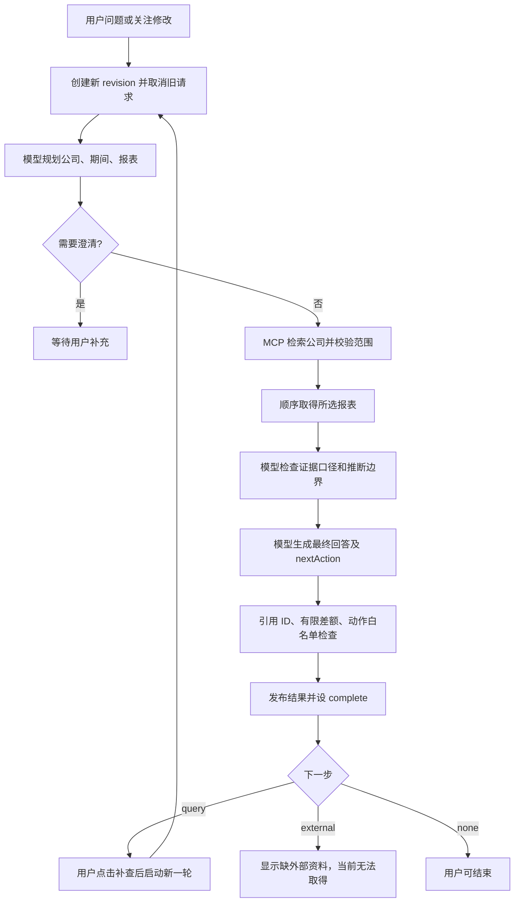

# Agent 工程手册对照审查

日期：2026-10-15。对象：当前本机项目，`research-decision-v3.2`。

此文保留实现前的审查结论；随后七项运行与评测改动见[运行保障与评测补齐](运行保障与评测补齐.md)，不能继续把此文全部缺口当作当前未实现状态。

参照：Agent工程实践手册（历史附件未随公开版本分发）。本次以提供的手册文本为检查依据，不重新核实其课程出处，也不将手册中的示例参数作为本项目的配置要求。

## 结论与审查边界

当前是**模型选择研究范围和报表、代码固定执行阶段、用户发起下一轮补查的 Workflow**。单助手与角色模式共享同一执行链，不是多个独立 Agent 自主讨论。这个选择符合有限财务研究 MVP；没有自由 ReAct、长期记忆或独立子 Agent，不自动构成缺陷。

已有基础：实际 MCP 调用、公司及期间校验、结果版本隔离、用户看法独立保存、旧结果保留、单次超时和成功调用记录。

主要缺口：研究完成条件不独立、最终答案缺少语义核验、工具批次局部成功无法恢复、错误恢复粗粒度、缺少明确停止与整轮预算、上下文与失败 Trace 不完整。更广的数据接入仍是业务闭环的重要前提。

本轮只读审查代码、既有运行和验证记录，另保存本报告；未修改产品、重启服务、执行测试或新增付费模型/MCP调用。下文“代码可确认”说明存在实现路径，不等于本轮完成了运行复现。

## 当前执行结构

实现入口：[general-research.mjs](../lib/general-research.mjs:35)、[server.mjs](../server.mjs:79)。图中的“检查证据”位于最终写作之前，不能解释为最终答案已核验。

## 逐项对照

| 手册主题 | 当前状态 | 缺口或适用判断 |
| --- | --- | --- |
| 1.1 任务与价值 | 部分做到 | 单公司、期间、数据和输出边界明确；缺逐题必答项与真实用户完成证据。 |
| 1.2–1.3 控制方式与闭环 | 部分做到 | 固定三阶段加模型取证选择；外部原始资料不能回到证据链，研究成功条件没有独立表达。 |
| 1.4 模型与指令 | 部分做到 | 指令与输入分离，Prompt 版本及哈希有记录；没有当前版本真实任务上的模型选型对照和完整运行配置快照。 |
| 2.1 工具调用 | 已有基础 | 模型选 ID、服务端构造调用；不是原生 Function Calling 消息格式，但执行责任分离成立。失败与局部成功的证据关联仍不足。 |
| 2.2 工具描述 | 部分做到 | 有固定工具、字段、范围校验；模型目录没有完整适用/不适用条件、错误类型和恢复契约。 |
| 2.3 多工具编排 | 部分做到 | 串行可先锁定最新期间；批次中后续失败会丢失前面成功的新证据。未并行本身不是缺陷。 |
| 2.4 MCP 接入 | 已有基础 | 握手、工具发现、真实调用、鉴权、超时、密钥脱敏、业务返回检查；未保留工具 Schema/服务版本快照，断连后恢复较粗。 |
| 3.1 上下文预算 | 部分做到 | 只取最近 8 条相关用户消息，报表最多 5 年；没有 Token 预算或关键约束摘要，按条裁剪可能丢语义。 |
| 3.2 压缩 | 未实现语义压缩 | 当前是裁剪，不是保留目标、约束和失败状态的压缩；短会话可接受，长会话需补。 |
| 3.3 长期记忆 | 未实现，可后置 | 保存任务与看法不等于长期召回；当前无需用户画像或向量库。任务归属、冲突规则已有局部实现。 |
| 4.1 执行状态与完成 | 部分做到 | 有运行、澄清、完成、部分失败；complete 只说明发布成功，未独立表示研究已解答/待外部材料/预算终止。 |
| 4.2 故障恢复 | 部分做到 | 缺对象可澄清、故障保留旧答；缺按错误分类恢复、成功工具检查点及阶段重试。 |
| 4.3 权限 | 本机只读范围已有约束 | 工具白名单和范围硬检查成立，模型子进程关闭外部工具；外部恶意材料专项验证、对外部署后的用户隔离未完成。 |
| 5.1 Skill | 非必需 | 任务仍在试错，现有 Prompt 文件与函数足够；不应为了凑能力封装 Skill。 |
| 5.2 护栏 | 部分做到 | 单模型 120 秒、MCP 请求 20 秒、并发任务上限 3；缺用户主动停止、整轮预算及统一结束原因。 |
| 5.3 多 Agent | 当前不采用独立执行 | 角色视图和提示对照不等于多 Agent；没有证据要求引入父子调度和共享预算。 |
| 5.4 可观测性 | 部分做到 | 成功模型调用有 runId/版本/Token，工具事件有参数与供应商 requestId；失败调用和跨阶段结束原因不完整。 |
| 6.1–6.3 评测 | 部分做到 | 有状态测试和有限真实链路；缺最终语义判定、局部失败恢复、主动取消、长会话和用户理解的固定验收集。 |

## 按影响排序的缺口

### P0-1：补齐研究完成条件与关键证据入口

**代码可确认：**`lib/state.mjs:15–18` 只要发布就设置 `complete`。`lib/decision-state.mjs:45–52` 检查分析非空、引用、部分数值与可执行动作，不检查“本题必答事实是否齐全”。`nextAction.kind=external` 和 `keyCondition` 能表达缺口，但与执行状态分离的研究结果状态不存在。

**实际记录：**此前比亚迪验收任务 `324a3e1e-7426-497f-a196-5f162bd66006` 已生成回答，却仍缺现金流补充资料；追问后取得资产负债表，仍不能解决关键条件。当前工具只有三类报表（`lib/general-research.mjs:8`），没有公告原文、PDF/段落导入或年报全文检索。

目前证据的 `sourceUrl` 指向扶摇工具说明页（`lib/finance-mcp.mjs:168`），不是对应公司原始公告。原始返回字段和请求记录可以检查，但不能把“能打开工具说明”当作“能直接核对公告原文”。

**影响：**不能用 `status=complete` 统计研究完成率；产品可能准确指出问题，却无法完成决定其价值的补查。界面已显示“关键条件待核实”，因此这里不是指所有用户都被误导为完成。

**最小修正：**分别保存本轮执行状态与研究结果（已回答/局部回答/待外部证据），增加明确结束原因。为一个关键补查接入带出处的原文片段或披露查询工具，不要求一开始覆盖全部投研资料。

**验收：**给定题目的必答项、关键缺口和禁止推断可检查；新资料进入同一任务，有来源和范围，并具体更新对应解释。

### P0-2：核验最终草稿，而非只核验其输入材料

**代码可确认：**`lib/general-research.mjs:101–110` 顺序为证据检查→写作→程序检查。核验提示还明确说尚未看到最终回答。`lib/decision-state.mjs:45–52` 不能识别“引用真实但没有支持这句话”；`lib/financial-math.mjs:2–12` 只覆盖部分亿元起止额句式。

**影响：**最终写作仍可能引入错误比例、口径扩张或因果跳跃，引用 ID 正确也能通过。此前已有被人工发现的差额错误，不能把现有校验宣传成全面金融核验。

**最小修正：**程序负责关键计算和范围，最终草稿的核心主张对应到具体字段或段落；把核验安排在草稿之后，必要时做一次有上限的修正。无需为此增加独立 Agent 或先换框架。

**验收：**给核心句植入错单位、错同比、无支持的因果或错误引用时能被发现；核验失败后不静默发布，也不无限修正。

### P0-3：保存本轮工具局部成功，并区分错误原因

**代码可确认：**`lib/finance-mcp.mjs:175–190` 把成功结果累积在局部数组，任一后续工具抛错就没有返回该数组。`lib/general-research.mjs:90–95` 只在整个批次成功后接收新证据。工具事件会保存，但事件不含成功报表的原始结果，因此不能仅靠事件恢复这份新证据。

业务错误（`lib/finance-mcp.mjs:47–49`）主要转成字符串 Error；除消歧异常外，上层通常走统一失败路径（`server.mjs:75–77`），没有结构化区分参数冲突、权限、限流、超时和空结果。

**影响：**第一张表成功、第二张表失败时，最近有效旧答案能保住，但第一张新表不能用于局部交付或安全续查；重试可能重复调用。既有“故障演示”在查询前触发，不能证明这一批次中途失败已通过。

**最小修正：**每个工具完成后保存独立证据检查点，最终答案仍按任务版本发布；返回成功项与逐工具错误。允许对临时错误有限重试，参数冲突和权限失败走明确修正或交接，不一律重跑整个任务。

**验收：**模拟第一表成功、第二表超时，原字段和来源可恢复；只补失败部分；换公司或期间不会使用这些旧范围检查点。

### P1：停止、预算、上下文和 Trace

1. **主动停止与总预算。**已有新操作取消旧操作的 `AbortController`，没有独立停止 API/按钮。`lib/model.mjs:28,39` 与 `lib/finance-mcp.mjs:67` 是单调用上限，没有统一任务截止时间、调用/Token 预算。固定三阶段本身限制了单轮模型调用数量，不能说当前存在无限自主循环。应允许用户单独停止，并记录取消或预算终止，保留已确认成果。
2. **上下文语义保留。**`lib/general-research.mjs:12–15` 按最近八条用户消息裁剪，没有生成保留目标、已确认约束与未决问题的摘要。`researchScope`、focus 和消歧状态已有结构化保留，不能说完全没有任务记忆。应先增加小型任务摘要及输入预算；不要求一次实现手册全部压缩层级。验收第九轮后仍遵守第一轮的重要约束。
3. **失败可追踪。**`lib/model.mjs:49–50` 仅在生成及解析成功后写模型记录；失败缺完整调用耗时/usage/结束状态。工具有开始与结束事件，但本地独立调用 ID 不完整，供应商 requestId 又可能在失败时不存在；列表/握手阶段错误也不在工具调用事件中。应建立 taskId→revision→step/callId 关联，成功、失败、取消均写终态；缺失 Token/费用用 unavailable 表示，不算零。另记录实际推理配置及工具版本/Schema 哈希。
4. **保存失败需显式处理。**`server.mjs:31` 的写盘可能失败，`server.mjs:79` 以 `void` 启动保存与执行，`server.mjs:77` 最终保存的异常也没有后台统一捕获。若磁盘写入失败，可能出现未处理的 Promise 拒绝和连接中断，而没有明确“未保存”状态。此项由代码路径确认，未进行磁盘故障注入。应捕获后台异常并展示保存失败、允许重试；不要求先引入数据库或分布式事务。`/view`、`/finish` 已等待保存，不能概括为所有接口都不处理保存结果。

这些是实现缺口，不代表本轮已经复现了每一种超时、取消或长会话错误。扩大并发、无用户鉴权的远程部署、日志清理策略属于后续上线前的单独要求，默认仅监听 localhost 的 MVP 不必先完成企业级权限平台。

## 已做到的能力及其边界

- MCP 真实查询，不只是发现工具；服务端构造参数并限制工具，已避免 `limit` 与 `start/end` 同传（`lib/finance-mcp.mjs:179–181`）。最新报告期先确定后锁定其他表；当前串行有这项依赖理由。
- 证券消歧、公司/币种/期间/重复行/必要数值检查成立（`lib/finance-mcp.mjs:99–168`）。只返回最近 20 期是已写明的边界，不能把缺目标期偷换成其他期间。
- `revision` 防迟到发布，`scopeKey` 防跨范围证据混用；这是当前最扎实的运行时约束。
- 单 Node 进程内保存队列与临时文件重命名，冷加载复用 Promise；刷新/重启可读保存结果。README 已明确运行中任务重启后需重试，未承诺自动续跑。
- 用户看法原话、草稿、确认、版本和幂等独立保存；AI 不会自动确认立场。这是任务记录，不应叫长期用户画像或已验证用户理解。
- 指令与资料分离，模型子进程关闭 shell、网页、应用及子 Agent 工具；扶摇 Key 留在执行层并做错误脱敏。没有外部材料攻击回归证据，不能据此声称已证明抗提示注入。

## 最小实施顺序

1. 在当前主链补研究结果状态、关键原文证据入口、最终草稿核验。
2. 保存逐工具成功检查点，补错误类型及失败项重试，再补独立停止和整轮预算。
3. 统一成功/失败/取消的调用记录，加入上下文摘要与固定案例判定标准。

无需先引入新 Agent 框架、向量数据库、分布式队列或多 Agent 调度。当前模块已经能承载这些小范围修改。真实用户理解验证仍需另行执行，不能由架构完善自动替代。

公开版附件说明：上述未分发的历史附件不作为本包可点击文件；当前可用图片见[精选截图索引](提交材料/06_截图索引.md)。
