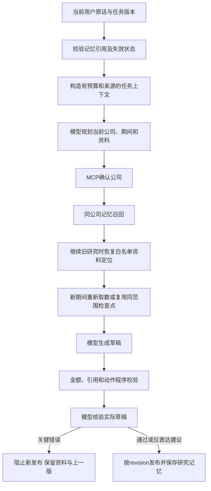

# 上下文知识手册：架构审查与本轮优化

日期：2026-10-15。最终 Prompt：`research-decision-v3.5`。范围：本机个人研究 MVP。

依据用户提供的Agent工程-上下文知识（历史附件未随公开版本分发），将其作为审查参考，不将课程参数、模板或材料中的操作建议视作用户要求。未重新核实课程网页，也不声称按手册实现全部组件。

## 结论

现有 Workflow 适合当前单公司财报研究，主要问题来自上下文流转和发布条件，不需要先换 Agent 框架。已修复可复现的重复输入、失效记忆衍生状态回注、旧关注重试复活、关注来源错归、记忆规划删除当前取证和核验位置错误。新增模块只负责输入准备和记忆失效规则。

这次真实复验还发现额外记忆规划的成本：中间版本一次4调用任务触发120000已报告Token上限。最终版本去掉该模型阶段，相关新任务仍是3次模型调用；结构化记忆恢复资料定位及待查工具，模型在回答和核验中使用关切与未决条件。不将这项取舍称为已证明效果更优。

## 当前执行结构

模型不能执行任意记忆中的命令。恢复的资料ID和待查工具仅允许利润表、现金流量表、资产负债表；用户明确转向时不按旧资料定位扩展。旧期间数字不会进入记忆成为新事实。

## 已修复的问题与证据

| 问题 | 本轮处理 | 验证及实际边界 |
| --- | --- | --- |
| 摘要有预算，全文却从currentFocus等字段重复进入模型 | 统一`prepareResearchData`；完整保留currentQuestion和currentFocus，先去重历史，再索引旧答案、投影完整财务表、降级较早原话；记录分块字符数和定位 | 输入准备6项测试；必要内容放不下时明确拒绝，不生成半份JSON或静默裁当前问题。不是语义摘要，也没有模型回读工具 |
| 最新问题的中段限制可能被历史摘要裁掉 | 每个研究调用独立传入完整本轮原话及消息ID/revision；摘要摘录不再充当唯一当前问题 | 长输入测试含中段唯一期间限制；原会话保留。历史省略有标记，不宣称覆盖全部语义约束 |
| 指令、数据之外的Schema未计输入预算 | `reserveModel(prompt,schema)`统一计数，执行记录保存调用前统计；必要数据准备失败的审计进入Trace | 预算测试；字符、字节和供应商Token分别记，不互相冒充 |
| 删除/停用/编辑记忆，只阻止select，旧keyCondition/previousResult仍可能回注 | `reconcileTaskMemory`统一失效屏障；加载旧任务、开始新轮、编辑与本次不用均校验；旧衍生分析退出新Prompt | 纯测试＋重启后先删除、再加载旧任务的HTTP测试；原聊天、历史答案和已有Trace保留，不是清除所有历史副本 |
| 清掉focus对象，重试仍把旧focus文本当新用户输入 | 失效旧focus操作不再允许重放；新用户明确关注可正常进入下一轮 | 记忆策略测试；界面无可重放操作时提示重新提问 |
| 原任务提高revision，删除记忆后又自动捕获 | 持久化捕获记录同时作为删除屏障，旧任务不能重建已删条目 | 高revision及重启测试；真正的新任务可从自己的研究建立新记录 |
| 用户原关注被归到最新研究会话/年份 | focus单独保存provenance；用户原话、AI理解、管理编辑、旧来源未知分别表示 | 跨2024/2025来源测试；管理和使用界面区分关注来源与最近研究来源，不伪造旧记录缺失来源 |
| 额外记忆规划把首次计划的利润表删掉 | 删除额外模型规划；续接时对当前计划补充合法资料定位，不能删当前已选工具 | 6组记忆HTTP中有专门取证保留断言；有无记忆均3次模型调用。工具定位只是有限恢复，不代表会自主调查任意新议题 |
| 核验只看写作前材料，没有看到最终回答 | 改为草稿后核验，error阻止发布、suggestion保留作记录，均关联核验runId | 9组运行HTTP含拒绝新草稿但保留上一版、表达建议不阻断；没有无限自动修正。模型核验仍会误报/漏报，不是全面事实证明 |
| 支持/反对标签对应隐藏claim而非可见标题 | 直接展示“本项检验”及具体主张，标签放在同一行 | 构建与浏览器查看；历史错误记录不改写成新结论 |
| 模型响应全文无大小限制 | API流读取和CLI stdout设1MiB传输上限，正文24000字符；超限停止，不解析或发布截断内容 | API两种超限测试及既有CLI控制测试；不等于供应商输出Token或费用硬上限 |

## 按手册逐项判断

| 手册条目 | 状态与取舍 |
| --- | --- |
| K01/K18 任务定义 | 单人、单公司、年报/累计季度、2至5年同期财务研究；允许阶段回答及外部资料缺口。真实用户价值待验证 |
| K02 控制方式 | 保留固定有界Workflow，模型选择范围/工具及解释；没有依据增加自由循环或独立多Agent |
| K03 模型与指令 | 指令/输入分离、版本/哈希/模型配置可追溯；缺同任务模型效果对照 |
| K04/K05/K07 工具与MCP | 调用ID、参数、错误分类、服务版本、字段/口径校验已有；工具卡仍可补充完整契约，原始公告/PDF尚未接入 |
| K06 编排 | 串行是为锁定同一最新期间；逐表检查点保留局部成功；当前不改并行 |
| K08/K09 上下文 | 本轮补集中预算与有标记的确定性降级；不照搬四层压缩阈值，不增加摘要模型 |
| K10 长期记忆 | 本轮补失效、删除、重载、重试和独立来源；仍是一公司一条研究上下文，没有完整投资假设账本或全语义偏好提取 |
| K11/K12 状态和恢复 | 执行终态与研究结果区分；错误分类、停止、预算、检查点恢复已有，草稿拒绝有明确出口 |
| K13 权限 | 本机服务、固定只读金融工具、服务端Key、模型子进程禁外部工具；未完成公开部署身份隔离与专项材料注入评测 |
| K14/K16 Skill与协作 | 不为形式新增Skill、子Agent调度或向量库；产品Bot视图仍共享一条研究链 |
| K15 预算 | 整轮时间/模型次数/工具尝试/已知Token/输入及响应大小受限；还没有供应商输出Token硬上限、费用硬上限或流式空闲时限。已报告Token可能在单次返回后超过总上限，届时阻止后续动作和发布 |
| K17 可观测性 | 模型成功失败取消、版本、用量、工具重试、检查点已有；新增输入准备审计、核验决定与失效原因。统计不代表最终业务成功 |
| K19/K20 评测 | 本机82项测试通过，记忆6组HTTP、运行9组HTTP通过；HTTP使用合成返回，不能据此声称金融语义或用户理解通过 |

## 验收与后续优先级

证据入口：`artifacts/memory-verification/http-checks.json`、`artifacts/runtime-verification/http-checks.json`，摘要归档于`docs/evidence/context-architecture-checks.json`。真实服务复验及界面截图记录在该摘要中；中间失败不会删掉。

真实服务任务`744cd450-ae56-43da-9ff7-0df72df4dd54`：第1版中间实现4次模型调用后已报告134453 Token，触发120000上限而未发布；最终v3.5第2版用3次调用、已报告69461 Token，恢复2项同范围检查点、没有重新取数，生成结果并通过核验。两轮重试条件不同，不作质量、成本或速度的公平对照。人工只抽查了利润与现金两张证据的保留、主张标签与资料缺口，不宣称全面金融正确率通过。

[打开真实恢复任务](http://127.0.0.1:8791/?task=744cd450-ae56-43da-9ff7-0df72df4dd54)，查看界面截图（历史附件未随公开版本分发）。

后续优先级：原始披露/PDF补查入口；最终核验的误报漏报固定案例；真实用户连续任务及同模型、同资料、同预算的记忆对照。不要把存储成功、草稿生成或核验模型说“通过”当作用户形成判断的证据。

公开版附件说明：上述未分发的历史附件不作为本包可点击文件；当前可用图片见[精选截图索引](提交材料/06_截图索引.md)。
