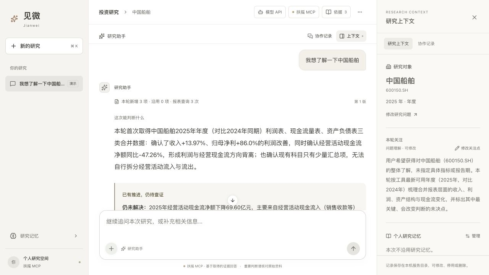
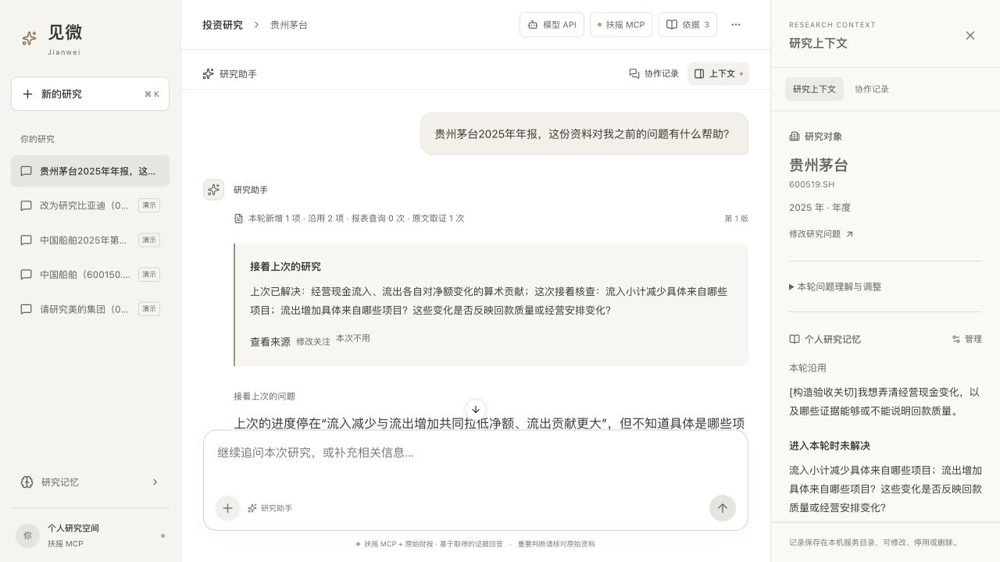
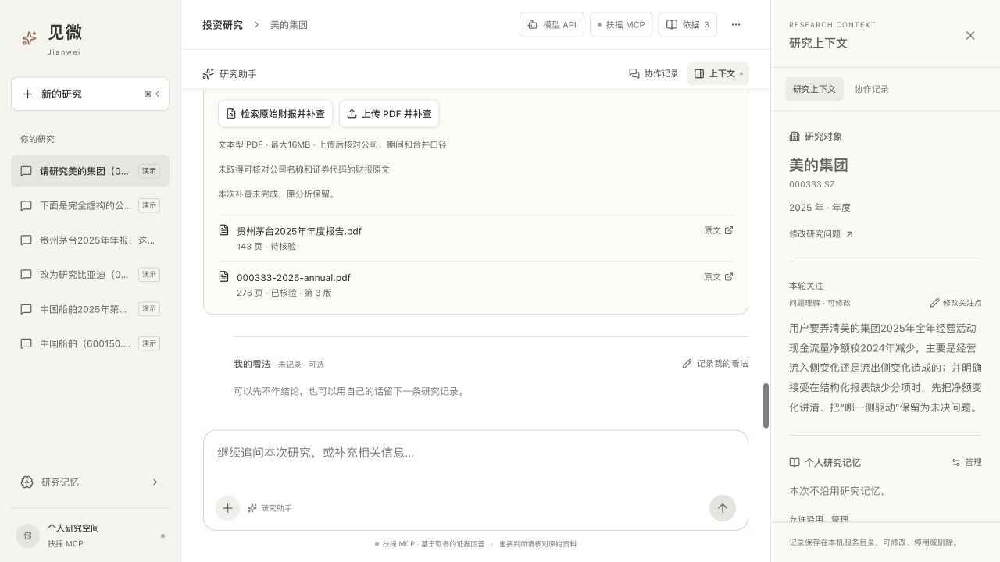

# 主演示与操作路径

## 一、评审从新任务开始

打开 [Web 产品](https://jianwei-investment-research-preview.onrender.com)，使用单独提供的预览凭证登录。当前生产环境是一个共享预览实例，请使用构造的关注与问题，不输入真实持仓或个人敏感信息。

可输入：

> 我想了解一下中国船舶。请解释最近全年财报中营收、归母净利润和经营现金流的历史变化，以及目前仍缺少什么依据。

该问题是一次实际完成的公网验收输入，不是固定案例入口。用户可换成另一家受支持的 A 股公司与年度/累计报告期。

**已记录结果：**2026-10-15 公网任务约 93 秒完成，取得利润表与现金流量表 2 项真实证据，规划、解释和最终核验共 3 次模型调用成功；最终状态为 `complete`，系统核验为 `passed`。这只证明该次链路完成，不是专家逐句复核或所有公司的成功率。

观察顺序：先读“这次能判断什么”及未决问题，再看财务图解/数据表，点击依据核对公司、报告期与字段。需要时再展开运行记录与协作侧栏。

## 二、用一个实例说明记忆怎样推进工作

以下是本机已保存的真实模型与原始财报链路，关注由验收构造，不代表用户真实投资偏好。演示公司仅为这个实例，不是产品默认对象。

| 阶段 | 原问题怎样推进 |
| --- | --- |
| 初次研究 | 关注经营现金流净额下降主要来自流入还是流出。结构化数据只有净额，因此保留分项缺口，没有推断客户回款变差。 |
| 一次补查 | 按贵州茅台与年度范围检索原始年报，取得合并现金流量表的流入、流出及有关分项；核对单位、列位、引文与勾稽。 |
| 首次判断变化 | 从“无法拆分”更新为“两侧共同压低净额，流出增加的算术贡献更大”。算术贡献已解决，变化原因和回款质量仍待核实。 |
| 新开会话 | 只问“这份资料对之前的问题有什么帮助”，不重复粘贴旧报告和关注。系统恢复同公司研究进度，不把已完成拆分重新列为未知。 |
| 继续推进 | 沿用两项旧证据，新读一项真实年报附注，解释部分项目线索，更新剩余条件。本次新增资料与沿用资料分开统计；该次约 128 秒完成。 |

## 三、在当前服务实例中体验连续性

先用明确的构造关注完成一次研究，再点击“新的研究”，提供同一公司和新的资料范围，询问“这次对我之前的问题有什么帮助”。检查是否实际恢复相关关注和未决条件，并把新资料用于推进问题。

若要补查，可使用回答中实际提供的“核查这一项”，或在已确认公司、期间后检索公告/上传不超过 16 MB 的文本型财报 PDF。当前支持范围集中于现金流分项和已有附注读取，不保证任意问题都能从文件中解决。新会话仅上传 PDF 就自动识别公司尚未实现。

纠正时可以区分：

- “这次只看另一问题”：改变本轮重点，不自动覆盖长期默认。
- “以后不沿用这个关注”：更新长期关注。
- “这不是我的观点，是转述”：纠正归属，不只在当前回复道歉。

Render 免费实例可能休眠或重启，旧任务链接和研究记忆不保证保留。上面的本机实例由截图和记录说明，不伪装成当前公网已预置的会话。若实例刚重启，请从一个新任务建立本次研究背景。

## 四、展示一次真实失败

已确认某家公司和报告期后，上传另一家公司的年报：系统应拒绝文件，不把错误主体纳入证据；若已有有效答案，应保留它并说明补查失败。

其他可查看的已记录场景：停止任务、工具权限失败、模型限流、补查失败保留上版，以及保存失败后的单独重试。截图中的合成故障均明确标注，不冒充上游真实故障。
