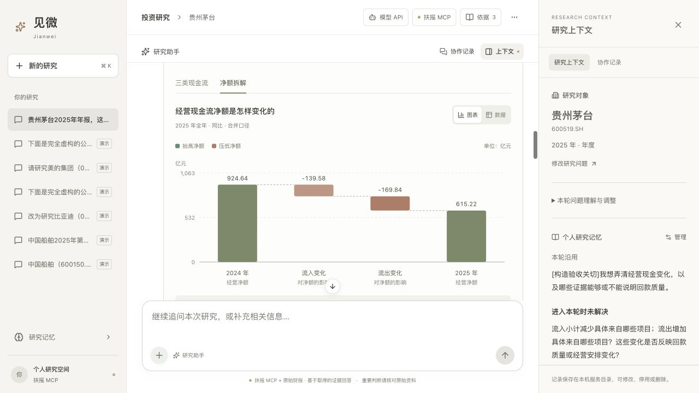

# 见微：接着上次的问题，把新资料变成判断依据

> 最终提交请优先阅读[提交入口](提交材料/00_提交入口.md)、[最终测试说明](提交材料/03_测试说明与验收状态.md)与[AI使用记录](提交材料/04_AI使用与验证记录.md)。下文保留各阶段历史记录，最新部署测试为158项，通过范围与失败按最终说明解释。

**目标用户：**反复研究同一家公司的个人投资者。新财报出现时，希望知道它对自己上次关心的问题有什么影响，不想重新交代背景、翻旧对话和读整份财报。

**核心任务：**保存可纠正的研究关注和未决问题 → 取得当期资料 → 解释已知与缺口 → 补查原始披露 → 更新阶段判断。用户可以始终不表达投资立场。

## 先看一个已跑通的任务

| 阶段 | 当前实现与真实验收 |
| --- | --- |
| 原始问题 | 经营现金流净额下降，主要发生在流入还是流出？这是构造的功能验收任务，非用户访谈。 |
| 初次结果 | 扶摇返回两年净额；缺分项，明确保留问题，不编造原因。 |
| 补查 | 按公司和报告期检索巨潮资讯原始年报，或上传文本PDF；核对公司、期间、合并口径、单位、原文及收支勾稽。 |
| 判断更新 | 贵州茅台：两侧共同影响，流出增加的贡献较大；美的：两侧均增加，但流出增加更多。具体出处见完整实例。 |
| 用户理解 | 瀑布图看贡献、切换数据表、点选数值，打开对应PDF页码；可将选中的变化带入对话追问。 |
| 失败 | 错误公司PDF被拒绝，旧版本上传返回409，最近有效结果保留。 |

[完整主演示](主演示实例.md) · 真实补查记录（原始记录本地保留；参见[公开测试摘要](evidence/public-test-summary.json)） · [图表交互验收](对话财务图解_2026-10-15.md)

## 为什么用 AI

搜索能找到报告，规则能计算差额；LLM承担的是把自然语言问题转成有范围的研究任务、从不同格式原文定位字段、解释新证据与旧问题的关系。计算、引用存在、公司期间、版本和预算由程序约束。

历史同资料有限对照没有证明多角色优势，默认保留同一助手分步执行。长期记忆的价值假设是减少重复交代和重复研究，已实现召回、纠正、本次不用、停用和删除屏障，部分序列有机制验收；长期观察、有无记忆的真实公平效果对照和Claude能力对照尚未完成。

## 模型连接

右上角“模型 API”可填写兼容API基址、模型名和Key，保存后验证并用于研究；也可继续使用已登录的本机Codex。[配置与验收](模型API配置入口_2026-10-15.md)。

## 交付与验证状态

- **源码与 README：**[GitHub 公开源码](https://github.com/rtyy5675-sys/investment-research-demo)，含锁文件、配置样例、提示词及测试。
- **Web：**[Render Web 预览](https://jianwei-investment-research-preview.onrender.com)，账号 `reviewer`，密码单独提供；当前验证边界见[部署状态](源码与部署状态.md)。也可本机运行 `npm ci`、`npm start`。
- **测试：**本次复查 `npm test` 为148/148通过，构建通过并有bundle体积提示。历史合成检查与真实补查记录见[测试说明](测试说明_提交版.md)。
- **AI记录：**[AI使用与验证记录](AI使用与验证记录.md)，包含真实失败及修正，不把AI审查冒充用户观察。
- **后续验证：**3–5名目标用户连续任务观察，以及同模型、资料、工具的有无记忆对照；当前未完成。

## 当前边界

本机单用户原型。A股年度和累计季度取数；沪深公告检索；PDF补查首条能力限经营现金流五项字段，完整真实验收为两家公司年报。无OCR、市场共识、股价定价、未来涨跌预测或直接买卖建议。数据缺失、冲突和错误须可见。旧文档是迭代记录，其中“尚未接入公告/PDF”等结论不代表当前实现。
